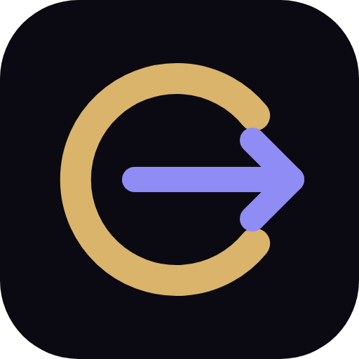

<p align="center"></p>

# Obstat

Obstat lets you install and run AI apps on your own computer in one click, with no terminal. It's coming soon for Windows, Mac and Linux, at [obstat.app](https://obstat.app).

- **Reviewed apps.** Every app on the Obstat list has been checked and tested by the Obstat team. Each one installs the exact version that was reviewed.
- **Any GitHub repo.** Paste a link and Obstat installs it in its own folder. You can try it in a sandbox first.
- **Runs inside Obstat.** Apps open in the Obstat window like a browser tab. They're kept apart from each other and from Obstat itself.
- **Build a UI.** If an app is only a command-line tool, Obstat makes a simple screen for it from its options. You can also ask Claude Code, Codex or Gemini CLI to build a custom one.
- **Skills.** AI agents on your PC can install and run apps through Obstat.
- **Updates itself.** New versions download in the background.

Inspired by [Pinokio](https://pinokio.co), and it runs Pinokio scripts.

## Run it from source

You need [Node.js](https://nodejs.org) 22 or newer.

```
npm ci
npm start             # open the app
npm test              # run the tests
npm run dist          # build the Windows installer into dist/
npm run dist:mac      # build the Mac .dmg files (Apple Silicon and Intel), on a Mac
npm run dist:linux    # build the Linux AppImage and .deb, on Linux
```

## Mac and Linux

The latest builds are on the [desktop-preview release](https://github.com/divinadevosai/obstat-desktop/releases/tag/desktop-preview).

- **Mac** (`Obstat-mac-arm64.dmg` for Apple Silicon, `Obstat-mac-x64.dmg` for Intel): Obstat isn't notarised by Apple yet, so the first time you open it macOS says it can't check it. Open **System Settings → Privacy & Security** and click **Open Anyway**. Obstat needs git, which comes with Apple's free Command Line Tools: if a window offers to install them, click Install.
- **Linux** (`Obstat-linux-x86_64.AppImage` runs on most distributions; `Obstat-linux-amd64.deb` for Ubuntu and Debian): Obstat needs git (`sudo apt install git`). To run the AppImage, make it executable (`chmod +x`) and open it.

What's different from Windows:

- **Sandbox:** on Windows, Obstat tests unreviewed repos in Windows Sandbox. On Mac and Linux it uses a separate test folder for now, and says so: that stops an app scattering files, but doesn't stop a hostile one reading yours.
- **Updates:** only the Windows app updates itself so far. On Mac and Linux, download the new version from the release.
- **GPU:** NVIDIA cards are used on Linux. On Apple Silicon Macs, apps are told about Apple's GPU, as in Pinokio.

## How it's put together

| Folder | What's in it |
|---|---|
| `main.js`, `preload.js` | Electron's main process, and the small bridge the window uses to talk to it |
| `app/` | The window: plain HTML, CSS and JavaScript, no framework |
| `lib/` | Everything else: installing (`apps.js`, `script.js`, `worker.js`), the in-app viewer (`viewer.js`), Build a UI (`buildui.js`, `ui-template/`), the sandbox, keys, skills, updates |
| `skills/` | The skills Obstat gives AI agents |
| `brand/` | Obstat's styles, logo and fonts, shared with obstat.app |

App scripts never run inside Obstat's own process. They run in a locked-down worker with no access to your keys.

## Contributing

Issues and pull requests are welcome. Please run `npm test` before opening a pull request. To report a security problem, see [SECURITY.md](SECURITY.md).

## Licence

The code is under the [MIT licence](LICENSE). The fonts in `brand/fonts` are under the SIL Open Font License. The Obstat name and logo belong to SWE3WE, so a fork should use its own name and logo.
